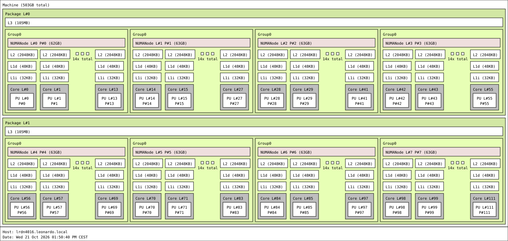
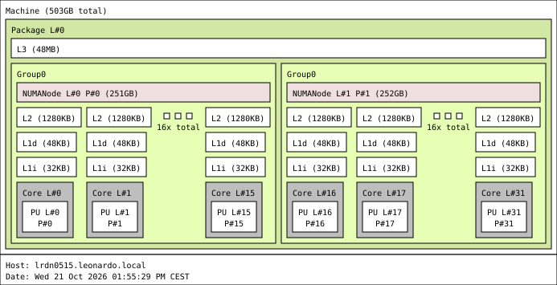



The diagrams below, generated with `lstopo`, show how CPU sockets, cores, caches, and NUMA memory are arranged within the cluster nodes. Use them when building your program as you can achieve better performance.

Click any diagram to view it at full size. In the labels, **PU** means processing unit (a logical CPU), **L#** is the logical index, and **P#** is the physical index reported by the operating system.

Please note that CPU only tasks will be scheduled on the DCGP partition, while GPU tasks will be scheduled on the Booster partition.  

## Compute node (DCGP partition)

This view shows two CPU sockets and eight NUMA nodes, with 503 GB of total memory reported by `lstopo`.

[](topology.svg)

## Booster node

The simplified view focuses on the CPU and memory hierarchy, with I/O devices hidden.

[](booster-topo-no-io.svg)

The full view also includes I/O devices and network interfaces.

[](booster_topo.svg)

## Software Environment

Below you can find the software environment available on the cluster nodes. 

### __GCC Version__
```bash
[fdebened@login01 ~]$ gcc --version
gcc (Spack GCC) 12.2.0
Copyright (C) 2022 Free Software Foundation, Inc.
This is free software; see the source for copying conditions.  There is NO
warranty; not even for MERCHANTABILITY or FITNESS FOR A PARTICULAR PURPOSE.
```
    
### __MPI Version__
```bash
[fdebened@login01 ~]$ mpirun --version
mpirun (Open MPI) 4.1.6

Report bugs to http://www.open-mpi.org/community/help/
```

### __NVCC Version__
```bash
[fdebened@login01 ~]$ nvcc --version
nvcc: NVIDIA (R) Cuda compiler driver
Copyright (c) 2005-2024 NVIDIA Corporation
Built on Thu_Mar_28_02:18:24_PDT_2024
Cuda compilation tools, release 12.4, V12.4.131
Build cuda_12.4.r12.4/compiler.34097967_0
```

### __GPUs Capabilities__
```
========== GPU: NVIDIA A100-SXM-64GB ==========
Compute capability:              8.0
PCI bus ID:                     0000:56:00
Streaming multiprocessors (SMs): 124
Warp size:                      32 threads
Core clock (reported):          1395 MHz

-- SM / occupancy limits --
Max threads / SM:               2048
Max warps / SM:                 64
Max resident blocks / SM:       32
32-bit registers / SM:          65536
32-bit registers / block:       65536
Shared memory / SM:             164.0 KiB (167936 B)
Shared memory / block:          48.0 KiB (49152 B)
Shared memory / block (opt-in): 163.0 KiB (166912 B)
Max threads / block:            1024
Max block dimensions (x,y,z):  1024, 1024, 64
Max grid dimensions (x,y,z):   2147483647, 65535, 65535

-- Memory hierarchy --
Global memory (device):         64944.8 MiB
Global memory (currently free): 64464.5 MiB
L2 cache:                       32.0 MiB
Constant memory:                64.0 KiB
Memory clock (reported):        1593 MHz
Memory bus width:               4096 bits
Peak memory bandwidth (est.):   1631.2 GB/s (DDR assumption)
ECC enabled:                    yes

-- Capabilities --
Concurrent kernel execution:    yes
Async copy engines:             5
Unified managed memory:         yes
Concurrent managed access:      yes
Host memory mapping:            yes
Cooperative kernel launches:    yes
Kernel execution timeout:       no
```
