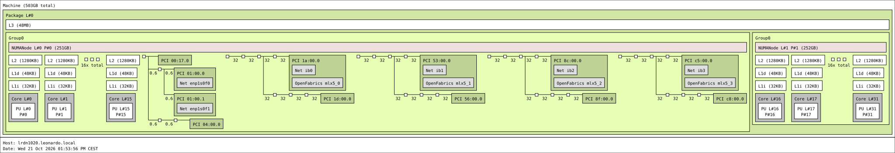

The diagrams below, generated with `lstopo`, show how CPU sockets, cores, caches, and NUMA memory are arranged within the cluster nodes. Use them when building your program as you can achieve better performance.

Click any diagram to view it at full size. In the labels, **PU** means processing unit (a logical CPU), **L#** is the logical index, and **P#** is the physical index reported by the operating system.

## Compute node

This view shows two CPU sockets and eight NUMA nodes, with 503 GB of total memory reported by `lstopo`.

## Booster node

The simplified view focuses on the CPU and memory hierarchy, with I/O devices hidden.

The full view also includes I/O devices and network interfaces.

